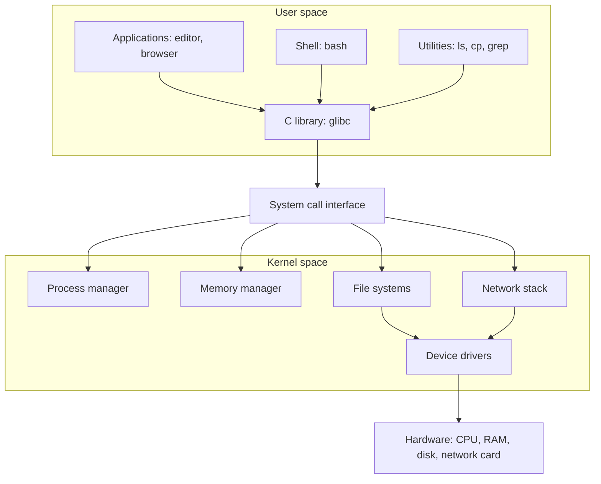
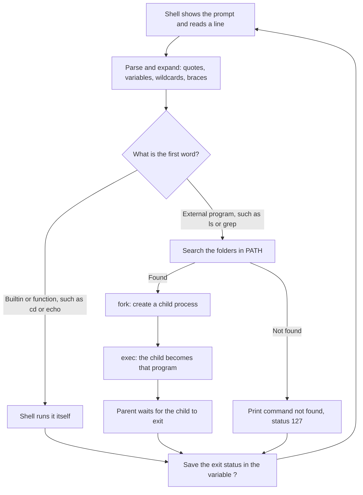
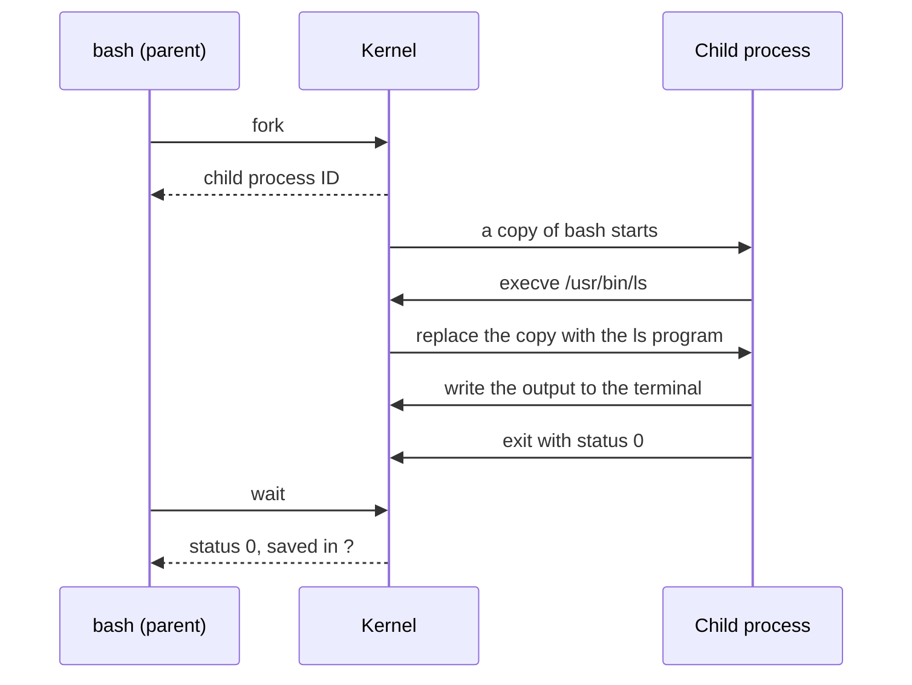

# **Components of Linux**

## **Overview**

A Linux system has two main components that you work with: the **shell** and the **kernel**. Other programs sit around them.

| Component | Role | Examples |
|---|---|---|
| Hardware | The physical machine | CPU, RAM, disk, network card |
| Kernel | Controls the hardware and shares it between programs | Linux kernel |
| Shell | Reads the commands you type and starts programs | `bash`, `zsh`, `sh` |
| Utilities and applications | Programs that do the actual work | `ls`, `cp`, `grep`, `vim`, a web browser |

The shell is the layer you talk to. The kernel is the layer that talks to the hardware. The layers diagram is in [01-introduction.md](01-introduction.md). This note looks at each layer in more detail.

---

## **Kernel**

The kernel is the core of the operating system. It starts when the machine boots and stays in memory until shutdown.

Main jobs of the kernel:

| Job | What it does |
|---|---|
| Process management | Creates and ends processes and decides which one uses the CPU and when |
| Memory management | Gives each process its own memory and keeps processes out of each other's memory |
| File systems | Reads and writes files on disks, and keeps ownership and permissions |
| Device drivers | Talks to hardware such as disks, keyboards, and network cards |
| Networking | Handles network connections and data |
| Security | Checks whether a user is allowed to do an action |

The Linux kernel is **monolithic**. These parts all run inside one kernel program. It can still load extra drivers at run time, which are called **kernel modules**.

To see your kernel version:

```bash
uname -r
```

### **User space and kernel space**

Programs do not touch the hardware directly. The CPU separates code into two areas:

- **Kernel space:** the kernel runs here with full access to the hardware.
- **User space:** the shell, utilities, and applications run here with limited access.

A program in user space that needs the hardware must ask the kernel. This request is called a **system call**.



Why this matters: a buggy program in user space can crash only itself. The kernel and other programs keep running.

Common system calls:

| System call | Purpose |
|---|---|
| `open`, `read`, `write`, `close` | Work with files |
| `fork` | Create a new process |
| `execve` | Replace a process with a new program |
| `wait` | Wait for a child process to finish |
| `exit` | End the process |

---

## **Shell**

The shell is a program that reads what you type, works out what you mean, and starts the right program. It is also a programming language, which is how shell scripts work.

What the shell does:

- Shows a prompt and reads one line of input
- Expands special characters, such as variables (`$HOME`), wildcards (`*.txt`), and braces (`{1..5}`)
- Finds the command to run
- Starts the program and waits for it to finish
- Provides pipes, redirection, variables, aliases, and scripting

The shell does not know in advance whether a command exists. It only finds out when it searches for the program. If the search fails, you get `command not found`.

### **Terminal and shell are different things**

| Term | Meaning |
|---|---|
| Terminal | The window that shows text and sends your keystrokes. Examples: Windows Terminal, GNOME Terminal |
| Shell | The program running inside the terminal that runs your commands. Example: `bash` |
| Command line (CLI) | The way of working by typing commands |

You can run different shells in the same terminal.

### **Common shells**

| Shell | Full name | Notes |
|---|---|---|
| `sh` | Bourne shell | The original Unix shell. Scripts that only use `sh` features run almost anywhere. |
| `bash` | Bourne Again shell | The default on most distributions, including Ubuntu. This repo uses it. |
| `dash` | Debian Almquist shell | Small and fast. It is `/bin/sh` on Debian and Ubuntu. |
| `zsh` | Z shell | Used by default on macOS. Many extra features. |
| `ksh` | Korn shell | Common on commercial Unix systems. |
| `csh`, `tcsh` | C shell | Syntax is like the C language. Rare on Linux. |
| `fish` | Friendly interactive shell | Easy to use, but not compatible with `bash` scripts. |

The program called `sh` is different on different distributions:

```bash
ls -l /bin/sh
```

- On Ubuntu and Debian, `sh` is a link to `dash`.
- On Red Hat family systems, `sh` is a link to `bash`.

A script that uses `bash` features, such as arrays or `[[ ]]`, can fail when run with `sh` on Ubuntu. Start such scripts with `#!/usr/bin/env bash`.

To see the shells installed on your system:

```bash
cat /etc/shells
```

To change your default login shell, run `chsh -s /bin/zsh`. It takes effect the next time you log in.

### **Utilities and applications**

Most commands you type, such as `ls`, `cp`, `mv`, and `cat`, are small separate programs. Many come from the **GNU project**, mainly the **coreutils** package. Because the kernel is Linux and many of the tools are GNU, the complete system is sometimes called **GNU/Linux**.

---

## **How a Command Runs**

[01-introduction.md](01-introduction.md) shows the basic flow. This is the detailed version.

### **What the shell does with a command line**



### **Builtin commands and external programs**

| Type | What it is | Examples |
|---|---|---|
| Builtin | Part of the shell itself. No new process is created. | `cd`, `echo`, `pwd`, `exit`, `type` |
| External program | A file on disk that the shell finds in `PATH` | `ls`, `cat`, `grep`, `cp` |
| Alias | A short name you define for a longer command | `ll` for `ls -l` |

`cd` must be a builtin. A child process cannot change the directory of its parent. If `cd` were a separate program, it would change its own directory and then exit, and your shell would stay where it was.

### **`PATH`**

`PATH` is a list of folders, separated by `:`. The shell searches them from left to right and runs the first match.

```bash
echo $PATH
```

Example output:

```text
/usr/local/sbin:/usr/local/bin:/usr/sbin:/usr/bin:/sbin:/bin
```

The current directory is not in `PATH`. This is why you must write `./test.sh` to run a script in the current folder.

### **Fork and exec**

An external program starts in two steps:

1. `fork`: the kernel makes a copy of the shell. This copy is the child process.
2. `exec`: the child replaces itself with the new program, such as `ls`.

The original shell, the parent, waits until the child finishes.



### **Exit status**

Every command ends with a number called the **exit status**. The shell stores it in `$?`.

| Status | Meaning |
|---|---|
| `0` | Success |
| `1` to `125` | The command failed. The meaning depends on the command. |
| `126` | The file exists but cannot be run, for example no execute permission |
| `127` | Command not found |

Scripts use the exit status to decide what to do next. See Phase 12 (control flow).

---

## **Users and the Prompt**

| Prompt ends with | User | Meaning |
|---|---|---|
| `$` | Normal user | Limited access. Cannot change system files. |
| `#` | Root (superuser) | Full access to everything |

```bash
akshay@ubuntu:~$ whoami
akshay
akshay@ubuntu:~$ sudo -i
root@ubuntu:~# whoami
root
root@ubuntu:~# exit
logout
akshay@ubuntu:~$
```

- `sudo -i` opens a root shell. It asks for your password.
- `exit` returns you to your normal user.
- `sudo command` runs only that one command as root. Prefer this to staying in a root shell.

As root, the system does not stop you from deleting important files. Permissions and `sudo` are covered in Phase 9.

---

## **Try It**

**Which shell am I running?**

```bash
echo $0                  # the shell you are running now
ps -p $$                 # same, using the shell's process ID ($$)
cat /etc/shells          # shells installed on this system
ls -l /bin/sh            # which program sh really is
```

Example output on Ubuntu:

```text
bash
    PID TTY          TIME CMD
   1234 pts/0    00:00:00 bash
/bin/sh -> dash
```

**Builtin or external program?**

```bash
type cd                  # cd is a shell builtin
type cat                 # cat is /usr/bin/cat
type -a echo             # echo exists as a builtin and as a program
which cd                 # which only finds programs, so this prints nothing or an error
```

On some systems the path is `/bin/cat` instead of `/usr/bin/cat`.

**Exit status:**

```bash
true; echo $?
false; echo $?
nosuchcommand; echo $?
```

Expected output:

```text
0
1
bash: nosuchcommand: command not found
127
```

The `;` runs the next command after the first one finishes.

**Run a shell script:**

```bash
nano test.sh
```

Type these lines, save, and exit:

```bash
#!/usr/bin/env bash
echo "Hello from a script"
whoami
```

Now run it:

```bash
./test.sh                # Permission denied, the file is not executable yet
chmod u+x test.sh        # add execute permission for the owner
./test.sh
```

Expected output:

```text
Hello from a script
akshay
```

The last line is your own username. The first line, starting with `#!`, tells the system which program should run the script.

**See system calls (optional):**

```bash
sudo apt install -y strace
strace -e trace=execve ls
```

The first line of the trace is an `execve` call that starts `/usr/bin/ls`. The exact output varies.

---

## **Common Mistakes**

| Mistake | What happens | Fix |
|---|---|---|
| Typing `test.sh` instead of `./test.sh` | `command not found`, because the current folder is not in `PATH` | Write `./test.sh` |
| Running `./test.sh` without `chmod` | `Permission denied` | Run `chmod u+x test.sh`, or run `bash test.sh` |
| Using `echo $SHELL` to see the running shell | Shows your default login shell, not the shell you are in now | Use `echo $0` or `ps -p $$` |
| Running a `bash` script with `sh script.sh` on Ubuntu | Errors on arrays and `[[ ]]`, since `sh` is `dash` | Use `bash script.sh` |
| Using `which cd` to check a command | Prints nothing, since `cd` is a builtin | Use `type cd` |
| Mixing up the terminal and the shell | Confusion when a shell is changed or a terminal is closed | Terminal is the window. Shell is the program in it. |
| Staying in a root shell after `sudo -i` | One wrong command can damage the system | Use `sudo command` for single tasks and `exit` when done |
| Using `gedit` on a server or WSL2 | `command not found`, because there is no desktop | Use `nano` or `vim` |

---

## **Summary**

- The main components are hardware, the kernel, the shell, and utilities or applications.
- The kernel manages processes, memory, files, devices, and networking.
- The kernel runs in kernel space. Everything else runs in user space and uses system calls to reach the kernel.
- The shell reads your commands, expands them, finds the program, and starts it.
- A terminal is the window. The shell is the program inside it.
- Common shells are `bash`, `sh`, `dash`, `zsh`, and `ksh`. On Ubuntu, `sh` is `dash`.
- Builtins like `cd` run inside the shell. External programs are found through `PATH`.
- An external program starts with `fork` and `exec`. The shell then waits and saves the exit status in `$?`.
- Exit status `0` means success. `127` means command not found.
- `$` is a normal user prompt. `#` is the root prompt.

---

## **Practice**

1. What is the job of the kernel? Name four things it manages.
2. What is the difference between user space and kernel space?
3. What is a system call? Name three.
4. What is the difference between a terminal and a shell?
5. Run `echo $0` and `cat /etc/shells`. Which shell are you using? How many shells are installed?
6. Run `ls -l /bin/sh`. Which program is `sh` on your system?
7. Run `type cd`, `type ls`, and `type cat`. Which are builtins, and which are programs?
8. Why can `cd` not be an external program?
9. Run `ls /nonexistent; echo $?`. What number do you get? Then run `true; echo $?`.
10. Create `test.sh` that prints your name. Run it before and after `chmod u+x`. What differs?
11. Run `echo $PATH`. In which folder does `cat` live?
12. What do `fork` and `exec` each do?