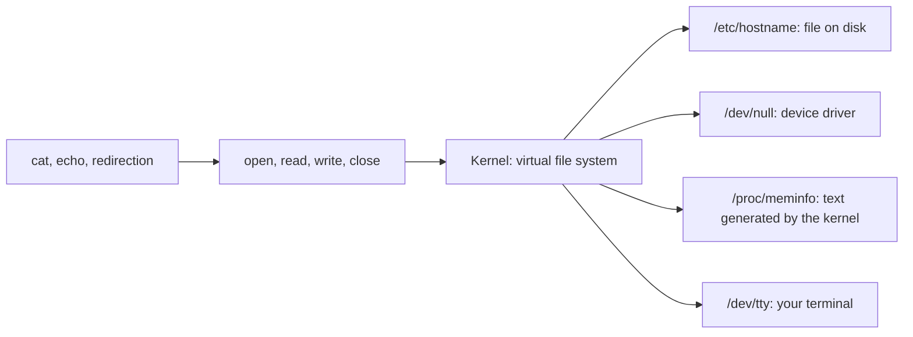

# **Everything is a File**

## **The Idea**

In Unix and Linux, many different things are used through the same interface as ordinary files. You open them, read from them, write to them, and close them. Regular files, directories, hardware devices, pipes, and even information from the kernel all look like files.

The saying "everything is a file" is a simplification. Some things, such as network interfaces, do not appear as files. For most of what you do in the terminal, the idea holds, and it is the reason Linux tools combine so well.

---

## **Why It Matters**

Programs only need to know four operations: `open`, `read`, `write`, and `close`. These are system calls (see [03-components.md](03-components.md)). The kernel decides what happens behind each path.



Benefits:

- **One set of tools:** `cat` can show a text file, read from a device, or print kernel information.
- **Redirection works everywhere:** `>` can send output to a file, a terminal, or a device.
- **Same permissions:** access to files, devices, and kernel data is controlled by the same owner, group, and permission bits.
- **Easy scripting:** system information is plain text, so you can read it with the text tools you learn in Phases 5 to 8 and 14.

---

## **What Appears as a File**

| Thing | Where you find it | Examples |
|---|---|---|
| Regular file | Anywhere | `/etc/hostname`, `notes.txt` |
| Directory | Anywhere | `/home`, `/etc` |
| Hardware device | `/dev` | `/dev/sda` (disk), `/dev/tty` (terminal) |
| Pseudo-device | `/dev` | `/dev/null`, `/dev/zero`, `/dev/urandom` |
| Kernel and process information | `/proc` | `/proc/cpuinfo`, `/proc/meminfo`, `/proc/1234/` |
| Devices and drivers | `/sys` | `/sys/class/net/` |
| Pipe | Created with `mkfifo` | `mypipe` |
| Socket | Usually under `/run` | `/run/docker.sock` |
| Symbolic link | Anywhere | `/bin/sh` |

A **directory** is a special file that holds a list of names and where to find each one.

### **Device files in `/dev`**

Programs talk to hardware by reading and writing the matching file in `/dev`.

| File | Behavior |
|---|---|
| `/dev/null` | Discards everything written to it. Reading it gives nothing. |
| `/dev/zero` | Gives an endless stream of zero bytes |
| `/dev/urandom` | Gives an endless stream of random bytes |
| `/dev/tty` | Your current terminal |
| `/dev/sda`, `/dev/nvme0n1` | Whole disks. Treat with care. |

Devices are either **character** devices (data moves one byte at a time, such as terminals) or **block** devices (data moves in blocks, such as disks). Details of each file type are in [05-file-types.md](05-file-types.md).

### **Virtual file systems: `/proc` and `/sys`**

These are not stored on a disk. The kernel creates their content at the moment you read them.

| Directory | Contains |
|---|---|
| `/proc` | Information about processes and the kernel. Each running process has a folder named after its process ID. |
| `/sys` | Information about devices and drivers, and some settings |

Many tools use these files. `ps` reads `/proc`, `free` reads `/proc/meminfo`, and `uptime` reads `/proc/uptime`.

### **Input and output as files**

Every process starts with three open files:

| Number | Name | Default | Path |
|---|---|---|---|
| 0 | Standard input (stdin) | Keyboard | `/dev/stdin` |
| 1 | Standard output (stdout) | Terminal | `/dev/stdout` |
| 2 | Standard error (stderr) | Terminal | `/dev/stderr` |

The numbers are called **file descriptors**. Redirection in Phase 6 works by pointing them at other files.

---

## **Try It**

**1. See the file type**

```bash
ls -ld /etc/hostname /etc /dev/null /bin/sh
```

Example output:

```text
-rw-r--r-- ... /etc/hostname
drwxr-xr-x ... /etc
crw-rw-rw- ... /dev/null
lrwxrwxrwx ... /bin/sh -> dash
```

The first character is the type: `-` regular file, `d` directory, `c` character device, `l` link.

**2. Use `/dev/null` and `/dev/zero`**

```bash
echo "hello" > /dev/null
ls /nonexistent 2> /dev/null; echo $?
head -c 8 /dev/zero > zeros.bin
ls -l zeros.bin
rm zeros.bin
```

- The first command prints nothing, since the output is discarded.
- The second hides the error message and prints the exit status, `2`.
- The third writes 8 zero bytes to a file, and `ls -l` shows a size of `8`.

Redirection with `>` and `2>` is covered in Phase 6.

**3. Read kernel information from `/proc`**

```bash
head -n 3 /proc/meminfo
cat /proc/version
cat /proc/uptime
ls -l /proc/cpuinfo
```

Example output (your numbers will differ):

```text
MemTotal:       16318468 kB
MemFree:         9876544 kB
MemAvailable:   14012345 kB
```

The `ls -l /proc/cpuinfo` line shows a size of `0`, yet `cat /proc/cpuinfo` prints many lines. The content does not exist on disk. The kernel makes it when you read it.

**4. Look at a running process**

```bash
echo $$
readlink /proc/$$/exe
head -n 1 /proc/self/status
```

- `$$` is the process ID of your shell.
- `/proc/<PID>/exe` is a link to the program that process runs. Expect `/usr/bin/bash`, or `/bin/bash` on older systems.
- `/proc/self` always refers to the process that reads it. Here that is `head`, so the output is `Name:	head`.

**5. List network interfaces from `/sys`**

```bash
ls /sys/class/net
```

Example output: `eth0  lo`. The names depend on your system.

**6. Standard streams are files**

```bash
ls -l /dev/stdout
```

Example output:

```text
lrwxrwxrwx ... /dev/stdout -> /proc/self/fd/1
```

**7. Named pipe (optional, needs two terminals)**

In terminal 1:

```bash
mkfifo mypipe
ls -l mypipe
cat mypipe
```

The `ls -l` line starts with `p`, meaning pipe. The `cat` command waits.

In terminal 2:

```bash
echo "hello" > mypipe
```

Terminal 1 now prints `hello` and `cat` exits. Clean up with `rm mypipe`.

---

## **Limits of the Idea**

- **Network interfaces** like `eth0` have no file in `/dev`. You use the `ip` command to manage them.
- **Not every socket has a path.** Only some, such as local sockets under `/run`, appear in the file system.
- **`/proc` and `/sys` files are not real stored data.** Their size shows as `0`, and they are not meant to be copied or backed up.

---

## **Safety**

- **Never write to a disk device** such as `/dev/sda` or `/dev/nvme0n1` as root. Commands like `echo x > /dev/sda` can destroy the whole disk.
- **Do not delete or replace `/dev/null`.** Many programs depend on it.
- **Do not change files under `/proc/sys` yet.** Writing there changes kernel behavior at once. The changes are lost on reboot, but a wrong value can cause problems.

---


## **Summary**

- Linux uses the file interface for regular files, directories, devices, pipes, and kernel information.
- Programs use four operations: `open`, `read`, `write`, and `close`.
- `/dev` holds device files. `/dev/null` discards data, and `/dev/zero` and `/dev/urandom` give endless data.
- `/proc` and `/sys` are virtual. The kernel creates their content when you read it.
- Standard input, output, and error are files with numbers 0, 1, and 2.
- The first character of `ls -l` shows the file type.
- The idea has limits. Network interfaces are not files.
- Never write to disk devices as root.

---

## **Practice**

1. What does "everything is a file" mean? Give three examples of things that are not ordinary files.
2. Name the four basic file operations.
3. What does `/dev/null` do? Give one use for it.
4. What is the difference between a character device and a block device?
5. Run `ls -l /proc/cpuinfo`. What size is shown? Why can `cat` still print its content?
6. Run `head -n 3 /proc/meminfo`. How much memory does your system have?
7. Run `cat /proc/version` and `uname -r`. What do they have in common?
8. Run `echo $$`, then `ls /proc/$$`. What is `$$`?
9. Why does `ls /nonexistent 2> /dev/null; echo $?` print only a number?
10. Which of these appear in `/dev`: a disk, a terminal, a network interface? Which do not?
11. What are file descriptors 0, 1, and 2?
12. Create a named pipe with `mkfifo`. Which character starts its `ls -l` line?