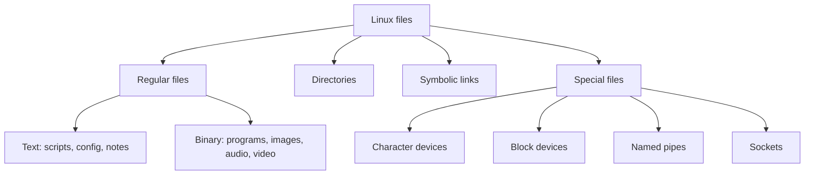

# **Linux File Types**

## **Overview**

Linux uses the file idea for many things. Every file has a **type**. There are seven types. Most of your work uses the first three: regular files, directories, and links.

| Type | Symbol in `ls -l` | Symbol for `find -type` | What it is | Example |
|---|---|---|---|---|
| Regular file | `-` | `f` | Text, programs, images, any data | `/etc/hostname`, `/bin/ls` |
| Directory | `d` | `d` | A list of names of other files | `/home` |
| Symbolic link | `l` | `l` | A pointer to another path | `/bin/sh` |
| Character device | `c` | `c` | A device read byte by byte | `/dev/null`, `/dev/tty` |
| Block device | `b` | `b` | A device read in blocks, such as a disk | `/dev/sda` |
| Named pipe (FIFO) | `p` | `p` | A one-way channel between programs | created with `mkfifo` |
| Socket | `s` | `s` | A two-way channel between programs | `/run/docker.sock` |



---

## **Regular Files**

A regular file holds data. The data can be:

- **Text:** readable characters. Examples: `notes.txt`, `index.html`, `script.sh`, `test.py`, configuration files.
- **Binary:** data meant for programs, not people. Examples: programs, `image.jpg`, `song.mp4`, compressed archives.

### **File extensions are not required**

Linux does not need an extension to know what a file is. The name `img.jpg` does not make a file a picture. The system looks at the **content**.

Extensions are still useful:

- They help people see what a file is.
- Some programs use them. A compiler expects `.c`, Python imports `.py`, and a desktop picks an app by extension.

### **The `file` command**

`file` reads the first bytes of a file and compares them with a database of known patterns. These first bytes are called the **magic number**.

| File | First bytes |
|---|---|
| Linux program (ELF) | `7F` then the letters `ELF` |
| PNG image | `89` then the letters `PNG` |
| PDF | `%PDF` |
| Shell script | `#!` followed by the program path |

```bash
file /bin/ls
head -c 4 /bin/ls | od -c
```

Example output:

```text
/bin/ls: ELF 64-bit LSB pie executable, x86-64, ...
0000000 177   E   L   F
0000004
```

The `177` is the byte `7F` written in octal. The pipe `|` is covered in Phase 6. If `file` is missing, install it with `sudo apt install file`.

### **Executable files**

A regular file can run as a program when it has the execute permission. The extension does not matter. A script named `backup` runs the same as `backup.sh`.

---

## **Directories**

A directory is a file that holds a list of names, and where to find each one. A directory can hold files and other directories.

- Windows calls them **folders**. Linux calls them **directories**.
- Every directory has two entries: `.` (itself) and `..` (its parent).
- You cannot read a directory with `cat`:

```bash
mkdir demo
cat demo
```

```text
cat: demo: Is a directory
```

Use `ls` to see what is inside.

---

## **Symbolic Links**

A symbolic link (symlink) is a small file that points to another path. When you open the link, Linux opens the target.

```bash
ls -l /bin/sh
```

```text
lrwxrwxrwx ... /bin/sh -> dash
```

- The `l` at the start marks a link. The `->` shows the target.
- Deleting the link does not delete the target.
- If the target is removed, the link is **broken**.

Creating links is covered in Phase 3.

---

## **Device Files**

Device files live in `/dev`. Reading or writing a device file talks to the device.

| Kind | How data moves | Examples |
|---|---|---|
| Character device (`c`) | One byte at a time, in order | Terminals, keyboards, `/dev/null` |
| Block device (`b`) | In blocks, with access to any position | Disks, partitions, USB drives |

```bash
ls -l /dev/null
```

```text
crw-rw-rw- 1 root root 1, 3 ... /dev/null
```

Instead of a file size, a device shows two numbers (`1, 3`). They are the **major** and **minor** numbers, which tell the kernel which driver to use.

Disks are named `sda`, `sdb`, or `nvme0n1` on real machines and `vda` on virtual machines. List the block devices with:

```bash
lsblk
```

### **Your terminal is a device file**

The `tty` command prints the device file of your terminal:

```bash
tty
```

```text
/dev/pts/0
```

`pts` means **pseudo-terminal**. Each terminal window gets its own number. You can write to another terminal of yours by writing to its file. See "Try It" below.

`Ctrl+D` sends "end of input". At an empty prompt, the shell takes it as a signal to exit, so it closes the terminal.

---

## **Named Pipes and Sockets**

Both let programs talk to each other.

- **Named pipe (`p`):** one-way. One program writes, another reads. Create one with `mkfifo name`.
- **Socket (`s`):** two-way. Used by services such as Docker and the system logger.

You will not create them often. You should know what `p` and `s` mean when you see them in `ls -l`.

---

## **How to Check a File Type**

| Method | Command | What it tells you |
|---|---|---|
| First letter of `ls -l` | `ls -l name` or `ls -ld name` | The type symbol |
| `file` | `file name` | The kind of content |
| `stat` | `stat -c %F name` | The type in words |
| Marker with `ls -F` | `ls -F` | `/` directory, `@` link, `*` executable, `\|` pipe, `=` socket |
| `find` | `find . -type d` | Only files of one type |

Colors are not reliable. Ubuntu shows directories in blue, but other distributions and terminal themes differ.

Use `-d` with `ls -l` on a directory, or you will see its contents instead of the directory itself.

---

## **Try It**

**1. Extensions do not matter**

```bash
mkdir ~/types-lab && cd ~/types-lab
touch img.jpg
ls -l img.jpg
file img.jpg
echo "Added some content" > img.jpg
cat img.jpg
file img.jpg
mv img.jpg img.unknown
file img.unknown
```

Example output:

```text
-rw-rw-r-- 1 akshay akshay 0 ... img.jpg
img.jpg: empty
Added some content
img.jpg: ASCII text
img.unknown: ASCII text
```

The permission letters may differ on your system. The name said picture, but the content is plain text, and renaming changed nothing.

**2. Check several types at once**

```bash
ls -ld /etc/hostname /etc /dev/null /bin/sh
stat -c %F /etc/hostname /etc /dev/null /bin/sh
```

```text
-rw-r--r-- ... /etc/hostname
drwxr-xr-x ... /etc
crw-rw-rw- ... /dev/null
lrwxrwxrwx ... /bin/sh -> dash
regular file
directory
character special file
symbolic link
```

**3. Make a broken link**

```bash
ln -s /tmp/does-not-exist broken
ls -l broken
cat broken
rm broken
```

`cat` prints `No such file or directory`, since the target is missing.

**4. Find your terminal**

```bash
tty
ls -l $(tty)
```

The second line shows a `c` and a number such as `136, 0`.

**5. Write to another terminal (optional, two terminals)**

Open two terminals. Run `tty` in each, for example `/dev/pts/0` and `/dev/pts/1`. In the first one, run:

```bash
echo "Hello from the first terminal" > /dev/pts/1
```

The text appears in the second terminal. This works only for terminals owned by you. To clear the other terminal:

```bash
clear > /dev/pts/1
```

Do not write to a `pts` number you do not know. It may be someone else's session.

**6. Clean up**

```bash
cd ~
rm -r ~/types-lab
```

---


## **Summary**

- Linux has seven file types: regular, directory, link, character device, block device, named pipe, and socket.
- The first character of `ls -l` shows the type: `-`, `d`, `l`, `c`, `b`, `p`, `s`.
- Extensions are for people and some programs. Linux decides by content.
- `file` reads the magic number at the start of a file to find its kind.
- A directory is a file that lists names.
- A symbolic link points to another path. Deleting the link keeps the target.
- Device files in `/dev` give access to hardware. Disks are block devices and terminals are character devices.
- `tty` shows your terminal's device file.
- Use `ls -ld`, `file`, or `stat -c %F` to check a type.
