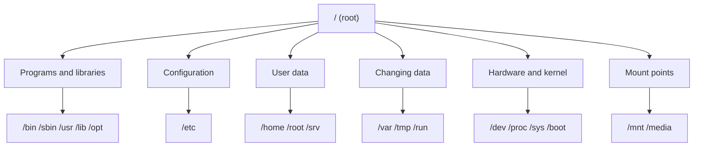

# **Linux File Hierarchy**

## **Overview**

Linux has **one directory tree** that starts at `/`, called the **root directory**. Every file on the system is somewhere under it.

- There are no drive letters such as `C:` or `D:`.
- Other disks, USB drives, and network shares are **mounted**. This means they are attached to a folder in the same tree.
- Names are case sensitive. `/Home` and `/home` are different.

The layout follows the **Filesystem Hierarchy Standard (FHS)**. Most distributions follow it closely, so you find things in the same place on Ubuntu, Debian, and Rocky Linux. A fixed layout lets programs and administrators find files without searching.



---

## **Top-Level Directories**

| Directory | Purpose | Examples |
|---|---|---|
| `/` | Top of the tree | |
| `/bin` | Essential commands for all users | `ls`, `cp`, `cat` |
| `/sbin` | Essential commands for system administration | `fsck`, `reboot` |
| `/usr` | Most installed programs, libraries, and shared data | `/usr/bin`, `/usr/share` |
| `/lib` | Libraries for programs in `/bin` and `/sbin`, and kernel modules | `/lib/modules` |
| `/opt` | Add-on software from outside the distribution | `/opt/google/chrome` |
| `/etc` | System-wide configuration files | `/etc/hostname`, `/etc/ssh/sshd_config` |
| `/home` | Home directories of normal users | `/home/akshay` |
| `/root` | Home directory of the root user | |
| `/srv` | Data that this system serves to others | web or FTP content |
| `/var` | Files that change while the system runs | logs, caches, spools |
| `/tmp` | Temporary files | |
| `/run` | Data about the system since it last booted | `/run/docker.sock` |
| `/dev` | Device files | `/dev/null`, `/dev/sda` |
| `/proc` | Process and kernel information | `/proc/meminfo` |
| `/sys` | Devices and drivers | `/sys/class/net` |
| `/boot` | Files needed to start the system | kernel, bootloader |
| `/mnt` | Mount point for temporary mounts by the administrator | |
| `/media` | Mount point for removable media | `/media/akshay/USB` |

Real systems may also show `/lost+found` (recovered file pieces on ext4), `/snap` (Ubuntu snap packages), and `/lib64`.

---

## **Details Worth Knowing**

### **`/bin`, `/sbin`, `/lib`, and `/usr`**

`/usr` holds most of the software. Its main parts:

| Directory | Contents |
|---|---|
| `/usr/bin` | Commands for all users |
| `/usr/sbin` | Administration commands |
| `/usr/lib` | Libraries |
| `/usr/share` | Shared data such as documentation and icons |
| `/usr/include` | Header files for programmers |
| `/usr/local` | Software that the administrator installs by hand. Package updates do not overwrite it. |

The name `usr` once meant "user", because early Unix kept home directories there. Later it was used for system software. It is also read as "Unix System Resources", but that is a later explanation.

**Merged `/usr`:** on most current distributions, `/bin`, `/sbin`, and `/lib` are links to `/usr/bin`, `/usr/sbin`, and `/usr/lib`. So `/bin/ls` and `/usr/bin/ls` are the same file. Check on your system:

```bash
ls -ld /bin /sbin /lib
```

```text
lrwxrwxrwx ... /bin -> usr/bin
lrwxrwxrwx ... /sbin -> usr/sbin
lrwxrwxrwx ... /lib -> usr/lib
```

### **`/etc`**

Configuration files for the whole system, mostly plain text. Examples:

| File | Holds |
|---|---|
| `/etc/hostname` | The machine name |
| `/etc/os-release` | The distribution name and version |
| `/etc/passwd` | User accounts |
| `/etc/fstab` | Disks to mount at boot |
| `/etc/ssh/sshd_config` | SSH server settings |

Edit these with care. A wrong line can stop the system from booting or logging in.

### **`/home` and `/root`**

- Every normal user has a folder in `/home`. Example: `/home/akshay`. It holds documents, downloads, and settings.
- The root user's home is `/root`, outside `/home`. A normal user cannot enter it.

| Symbol | Means | Example |
|---|---|---|
| `/` | The top of the whole tree | |
| `/root` | The root user's home directory | |
| `/home/akshay` | A normal user's home directory | |
| `~` | Shortcut for the current user's home | `/home/akshay` for akshay |

### **`/var`**

"Variable data". It holds files that grow or change while the system runs:

| Path | Contents |
|---|---|
| `/var/log` | Log files |
| `/var/cache` | Cached data |
| `/var/spool` | Queued jobs, such as mail and print jobs |
| `/var/lib` | Program state, such as databases and Docker data |
| `/var/tmp` | Temporary files that are kept across reboots |
| `/var/www` | Web server files on Debian and Ubuntu |

When a disk fills up, `/var` is often the cause. Large logs are a common reason.

### **`/tmp`**

Temporary files for programs and users.

- Anyone can create files here.
- Do not keep important data in it.
- The standard only **recommends** that `/tmp` is cleared at boot. Some systems do this, and some distributions, such as Debian 13, keep `/tmp` in memory (tmpfs), so it is lost at reboot and takes up RAM. Do not rely on it either way.
- Use `/var/tmp` when files must survive a reboot.

```bash
ls -ld /tmp
```

```text
drwxrwxrwt ... /tmp
```

The `t` at the end is the **sticky bit**. Everyone can create files in `/tmp`, but you can delete only your own.

### **`/mnt` and `/media`**

| Directory | Used for | Who mounts |
|---|---|---|
| `/mnt` | A temporary mount | The administrator, by hand |
| `/media` | USB drives, CDs, and other removable media | Usually the desktop, automatically |

Desktop systems mount a USB drive under `/media/<user>/<label>`. Mounting is covered in Phase 19.

### **`/opt`**

Add-on application packages that bring their own files, such as Google Chrome or commercial software. Each package usually gets its own folder, for example `/opt/google/chrome`.

### **`/srv`**

Data that the system serves to others, such as website or FTP files. Many distributions leave it empty and use `/var/www` instead.

### **`/run`**

Runtime data since the last boot, such as running service information and sockets. It is cleared at every boot, and is stored in memory.

### **`/dev`, `/proc`, and `/sys`**

These are not stored on disk. The kernel creates them. See [04-everything-is-a-file.md](04-everything-is-a-file.md).

- `/dev`: device files such as `/dev/null`. Old names such as `hd` (IDE disks) are now `sd`, `nvme`, or `vd`. `/dev/stdin`, `/dev/stdout`, and `/dev/stderr` point to your input and output.
- `/proc`: process and kernel information. Each running process has a folder named after its process ID. `ps -ef` shows the processes.
- `/sys`: devices and drivers.

### **`/boot`**

Files needed to start Linux: the kernel (`vmlinuz-*`), the initial RAM disk (`initrd.img-*`), and the bootloader (GRUB) files. Do not delete these. On WSL2 this folder is mostly empty, because Windows provides the kernel.

---

## **File Systems**

The **hierarchy** is the folder layout. A **file system** is the format used to store data on a disk. They are different things.

| File system | Used by |
|---|---|
| ext4 | Default on Ubuntu and Debian |
| XFS | Default on RHEL, Rocky Linux, and AlmaLinux |
| Btrfs | Default on Fedora Workstation and openSUSE |
| NTFS | Windows disks |
| FAT32, exFAT | USB drives |

One tree can combine several file systems. For example, `/` can be ext4 and `/media/akshay/USB` can be exFAT. Details are in Phase 19.

---

## **If You Use WSL2**

- Windows drives appear under `/mnt`. Your `C:` drive is `/mnt/c` and `D:` is `/mnt/d`.
- You can open your Linux files from Windows at `\\wsl.localhost\Ubuntu`, if your distribution is named Ubuntu.

---

## **Where Do I Find...?**

| I want to find or put... | Look in |
|---|---|
| A system setting | `/etc` |
| A log file | `/var/log` |
| A command | `/usr/bin` (or `/bin`) |
| My own scripts | `~/bin` or `/usr/local/bin` |
| My documents | `~` (`/home/<user>`) |
| Temporary work | `/tmp` |
| Third-party software | `/opt` |
| A mounted USB drive | `/media` |
| Information about a process | `/proc/<PID>` |
| The kernel | `/boot` |

---

## **Try It**

```bash
ls /
ls -l /
ls -ld /bin /sbin /lib
ls /usr
ls /var
ls /var/log
cat /etc/hostname
cat /etc/os-release
ls /home
ls -ld /tmp
echo ~
df -h /
```

`df -h /` shows the disk that holds `/`, and how full it is.

Move around the tree:

```bash
cd /
pwd
cd ~
pwd
cd /root
```

The last command should fail:

```text
bash: cd: /root: Permission denied
```

A normal user cannot enter `/root`. Check with `ls -ld /root`, which shows `drwx------`.

On WSL2:

```bash
ls /mnt
ls /mnt/c
```

---

## **Common Mistakes**

| Mistake | What happens | Fix |
|---|---|---|
| Mixing up `/` and `/root` | You look in the wrong place | `/` is the top of the tree. `/root` is the root user's home. |
| Saving important files in `/tmp` | They can be lost at reboot | Use your home directory or `/var/tmp` |
| Editing files in `/proc` or `/sys` | Changes affect the running kernel, and are lost at reboot | Read them. Change settings only when you know why. |
| Copying your own programs into `/usr/bin` | The package manager owns that folder, and updates can conflict | Use `/usr/local/bin` or `~/bin` |
| Looking for a `C:` drive | Not found | Use `/mnt/c` on WSL2 |
| Assuming `/bin` and `/usr/bin` differ | On merged systems they are the same | Check with `ls -ld /bin` |
| Using `/mnt` and `/media` as the same | USB mounts end up in the wrong place | `/mnt` is manual and temporary. `/media` is for removable media. |
| Running `rm -rf` with a path that starts with `/` | Deletes system files with no undo | Check the path first. Never run it with a variable that may be empty. |

---

## **Summary**

- Linux has one tree that starts at `/`. There are no drive letters.
- The FHS defines the layout, so every distribution looks alike.
- Programs are in `/bin`, `/sbin`, `/usr`, `/lib`, and `/opt`. On most systems the first three of these are links into `/usr`.
- Configuration is in `/etc`. Logs and changing data are in `/var`.
- Users live in `/home`. The root user lives in `/root`. `~` means your own home.
- `/tmp` is temporary, and it may be cleared at boot or kept in memory.
- `/dev`, `/proc`, and `/sys` are created by the kernel, not stored on disk.
- `/mnt` is for manual mounts. `/media` is for removable media.
- A file system (ext4, XFS) is the disk format. The hierarchy is the folder layout.
- On WSL2, Windows drives are in `/mnt/c`, `/mnt/d`, and so on.

---

## **Practice**

1. What is the root directory? How is it different from `/root`?
2. Why does Linux have no drive letters? How are other disks added?
3. Run `ls -ld /bin`. Is it a link? What does that tell you about `/usr`?
4. Which directory holds configuration files? Name two files in it.
5. Where do log files live? List the contents of that folder.
6. What is the difference between `/mnt` and `/media`?
7. Why should you not store important files in `/tmp`? Where could you store them instead?
8. What does the `t` in `drwxrwxrwt` mean on `/tmp`?
9. Run `echo ~` and `pwd` after `cd ~`. What do they show?
10. Try `cd /root` as a normal user. What happens, and why?
11. Which directories are not stored on disk?
12. What is the difference between a file system and the file hierarchy? Name two file systems.
13. Where would you put a script that all users should run?
14. On WSL2, which path is your Windows `D:` drive?