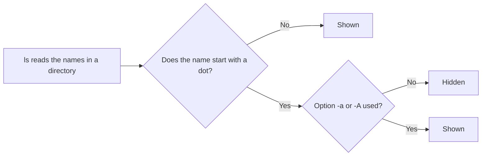

# **Hidden Files and Directories**

In Linux, a file or directory is **hidden** when its name starts with a dot (`.`). Examples: `.bashrc`, `.ssh`, `.git`.

- There is no special setting. The dot in the name is the only thing that makes it hidden.
- Hidden files are skipped by `ls` and by graphical file managers.
- They are not secret or protected. Anyone can see them with the right option.
- All system files that the kernel and programs need for settings are usually hidden files.

The purpose is to keep **configuration files** out of sight, so your home directory is not full of clutter. The idea began in early Unix as a shortcut to hide `.` and `..`, and then people used it for configuration files too.



---

## **Show Hidden Files**

| Command | What it shows |
|---|---|
| `ls` | Only normal files |
| `ls -a` | All files, including hidden ones, plus `.` and `..` |
| `ls -A` | All hidden files, but not `.` and `..` |
| `ls -la` | Long format with all files |
| `ls -ld .name` | Details of one hidden file or directory |

`-A` is usually cleaner, because `.` and `..` are not files you work with.

Note: the option `-a` shows hidden files. The option `-l` only gives the long format (permissions, owner, size, date). It does not show hidden files by itself. Use `-la` to get both.

In graphical file managers, press `Ctrl+H` to show or hide hidden files. This works in Nautilus on Ubuntu.

---

## **Create Hidden Files and Directories**

Put a dot at the start of the name. You create a hidden file the same way as a normal file. Only the name is different.

**With `touch` (empty file):**

```bash
touch .securefile1.txt
```

**With `cat` (type the content yourself):**

```bash
cat > .securefile2.txt
```

Type your text, then press `Ctrl+D` on a new line to save and exit.

To add more lines to the end of the file later, use `>>`. A single `>` would replace the old content.

```bash
cat >> .securefile2.txt
```

Type the new line, then press `Ctrl+D`.

**With an editor:** editors can create hidden files too, and you can edit hidden files like normal files.

```bash
gedit .securefile1.txt
```

**Hidden directories:**

```bash
mkdir .db_info
mkdir .private
```

Only the **name you list** is hidden. Inside a hidden directory, files are normal. You can `cd` into it, and `ls` works as usual:

```bash
cd .private
ls
```

---

## **Convert Between Normal and Hidden**

You can change a normal file into a hidden file, and back, by renaming it with `mv`.

```bash
mv a.txt .a.txt          # normal file to hidden file
mv .a.txt a.txt          # hidden file to normal file
mv dir1 .dir1            # normal directory to hidden directory
mv .dir1 dir1            # hidden directory to normal directory
```

---

## **The Special Entries `.` and `..`**

Every directory contains two entries that `ls -a` shows:

| Entry | Means | Example |
|---|---|---|
| `.` | The current directory | `./script.sh`, `cp file.txt .` |
| `..` | The parent directory | `cd ..`, `ls ..` |

They are hidden because they start with a dot. They exist in every directory, so you can always go up with `cd ..`.

### **Navigation commands that use them**

| Command | What it does |
|---|---|
| `cd .` | Stays in the current directory. It has no effect, so it is rarely used. |
| `cd ..` | Goes to the parent directory. |
| `cd` | Goes to your home directory (no argument). |
| `cd ~` | Goes to your home directory. The tilde `~` means home. |
| `cd -` | Goes back to the previous directory you were in. |
| `cd ../../..` | Goes up three levels. |

Example:

```bash
pwd
ls -a
cd ../../..
pwd
cd -
```

Sample output:

```text
/home/akshay/Documents/DurgaSoft_Linux/tempdirectory
.  ..
/home/akshay
/home/akshay/Documents/DurgaSoft_Linux/tempdirectory
```

A new empty directory shows only `.` and `..` with `ls -a`. That is how you can tell it is empty, even with hidden files in mind.

---

## **Common Hidden Files and Directories**

Most of these are in your home directory (`~`).

| Name | Purpose | Covered in |
|---|---|---|
| `.bashrc` | Settings for each new interactive bash shell: aliases, prompt | Phase 11 |
| `.profile`, `.bash_profile` | Settings for login shells | Phase 11 |
| `.bash_logout` | Commands run when a login shell exits | Phase 11 |
| `.bash_history` | List of commands you typed | Phase 1 |
| `.ssh/` | SSH keys and settings | Phases 18, 21 |
| `.config/` | Settings of many programs | |
| `.local/` | User-installed data and programs | |
| `.cache/` | Temporary data kept by programs. Safe to delete. | |
| `.vimrc` | Settings for vim | Phase 10 |
| `.gitconfig` | Your Git name, email, and settings | Phase 22 |
| `.git/` | The history of a Git project, inside the project folder | Phase 22 |
| `.gnupg/` | GPG encryption keys | |
| `.docker/` | Docker client settings | Phase 22 |
| `.env` | Settings for a project. Often contains passwords. | |

These are called **dotfiles**. Many people keep them in a Git repository to copy their setup to new machines.

---

## **Hiding Is Not Security**

A hidden name only keeps a file out of the normal `ls` list. Anyone can run `ls -a` and see it. To really protect a file, use **permissions** with the `chmod` command.

```bash
chmod 600 .securefile1.txt     # owner can read and write, nobody else
chmod 700 .db_info             # owner can enter and use the directory, nobody else
ls -ld .securefile1.txt .db_info
```

Example output:

```text
-rw------- 1 akshay akshay 0 ... .securefile1.txt
drwx------ 2 akshay akshay 4096 ... .db_info
```

You can also remove your own access to see how permissions work:

```bash
chmod u-rw demo.txt     # remove read and write for the owner
cat demo.txt            # cat: demo.txt: Permission denied
chmod u+rw demo.txt     # give them back
cat demo.txt            # works again
```

The superuser (root) can still read any file. Full details come in Phase 9.

---

## **Hidden Files and Wildcards**

A wildcard such as `*` does **not** match names that start with a dot. This affects many commands.

| Command | Result |
|---|---|
| `ls *` | Skips hidden files |
| `cp -r project/* backup/` | Does not copy hidden files such as `.env` or `.git` |
| `rm *` | Does not delete hidden files |

To include hidden files:

| Goal | Use |
|---|---|
| Copy a directory with everything inside | `cp -r project/. backup/` |
| Match hidden names only, without `.` and `..` | `.[!.]*` |
| Make `*` match hidden files too | `shopt -s dotglob` (undo with `shopt -u dotglob`) |

Preview a wildcard with `echo` before you use it with `rm`:

```bash
echo .[!.]*
```

Be careful with `.*`. On older versions of bash it also matches `.` and `..`. Bash 5.2 and newer skip them. Do not run `rm -r .*`.

---

## **Hidden Files in Linux and Windows**

| | Linux | Windows |
|---|---|---|
| How a file is hidden | The name starts with `.` | A "hidden" attribute is set on the file |
| Change it | Rename the file | Change the file's properties |

On WSL2, files under `/mnt/c` that Windows marks as hidden are not hidden in Linux unless their name starts with a dot.

---

## **Try It**

**1. Create and show hidden files**

```bash
mkdir ~/hidden-lab && cd ~/hidden-lab
touch visible.txt .hidden.txt
mkdir .secret-dir
echo "top secret" > .secret-dir/note.txt
ls
ls -a
ls -A
ls -la
```

Example output:

```text
visible.txt
.  ..  .hidden.txt  .secret-dir  visible.txt
.hidden.txt  .secret-dir  visible.txt
total 12
drwxr-xr-x  3 akshay akshay 4096 ... .
drwxr-x--- 12 akshay akshay 4096 ... ..
-rw-r--r--  1 akshay akshay    0 ... .hidden.txt
drwxr-xr-x  2 akshay akshay 4096 ... .secret-dir
-rw-r--r--  1 akshay akshay    0 ... visible.txt
```

Sizes and numbers will differ on your system.

**2. Create hidden files with `cat` and add a line**

```bash
cat > .securefile2.txt
```

Type `first line`, press Enter, then press `Ctrl+D`.

```bash
cat >> .securefile2.txt
```

Type `second line`, press Enter, then press `Ctrl+D`.

```bash
cat .securefile2.txt
```

Expected output:

```text
first line
second line
```

**3. Read inside a hidden directory**

```bash
cat .secret-dir/note.txt
ls .secret-dir
```

Both work. Only the name `.secret-dir` is hidden.

**4. Hide and show an existing file**

```bash
mv visible.txt .visible.txt
ls
ls -A
mv .visible.txt visible.txt
```

**5. Hide and show a directory**

```bash
mkdir dir1
mv dir1 .dir1
ls -A
mv .dir1 dir1
```

**6. Move around with `.` and `..`**

```bash
cd .secret-dir
pwd
cd ..
pwd
cd -
pwd
cd ~
pwd
```

`cd -` takes you back to `.secret-dir`, and `cd ~` takes you home.

**7. See how wildcards treat hidden files**

```bash
cd ~/hidden-lab
echo *
echo .[!.]*
shopt -s dotglob
echo *
shopt -u dotglob
```

Expected output (the exact list depends on the files you created above):

```text
dir1 visible.txt
.hidden.txt .securefile2.txt .secret-dir
.hidden.txt .securefile2.txt .secret-dir dir1 visible.txt
```

**8. The copy trap**

```bash
mkdir proj backup1 backup2
touch proj/a.txt proj/.env
cp -r proj/* backup1/
cp -r proj/. backup2/
ls -A backup1 backup2
```

```text
backup1:
a.txt

backup2:
.env  a.txt
```

The first copy missed `.env`.

**9. Protect a hidden file with permissions**

```bash
chmod 600 .securefile2.txt
ls -l .securefile2.txt
chmod u-rw .securefile2.txt
cat .securefile2.txt
chmod u+rw .securefile2.txt
cat .securefile2.txt
```

The first `cat` gives `Permission denied`. The second one works.

**10. Look at your home directory**

```bash
cd ~
ls -A
head -n 5 ~/.bashrc
ls -ld ~/.ssh
```

`.ssh` exists only if you have used SSH. If not, you get `No such file or directory`.

**11. Clean up**

```bash
cd ~
rm -r ~/hidden-lab
```

---

## **Common Mistakes**

| Mistake | What happens | Fix |
|---|---|---|
| Thinking a hidden file is secure | Anyone can see it with `ls -a` | Use permissions with `chmod` (Phase 9) |
| Thinking your files vanished because `ls` shows nothing | They are hidden | Run `ls -a` |
| Using `ls -l` to find hidden files | `-l` only changes the format. Hidden files stay hidden. | Use `ls -la` or `ls -lA` |
| Using `>` when you want to add a line | `cat > file` replaces the old content | Use `cat >> file` to add to the end |
| Forgetting `Ctrl+D` after `cat > file` | The command keeps waiting and the text may not be saved | Press `Ctrl+D` on a new line |
| Copying with `cp -r dir/* dest/` | Hidden files are left behind | Use `cp -r dir/. dest/` |
| Running `rm -r .*` | May match `..` on older shells and reach the parent directory | Preview with `echo .[!.]*`. Delete names one by one. |
| Typing `bashrc` instead of `.bashrc` | `No such file or directory` | Include the dot |
| Deleting `.git`, `.ssh`, or `.gnupg` | Loses project history or keys | Back them up first. Know what a folder is before you remove it. |
| Editing `.bashrc` with no backup | A mistake can break every new shell | Run `cp ~/.bashrc ~/.bashrc.bak` first |
| Committing `.env` to Git | Passwords become public | Add `.env` to `.gitignore` |

---

## **Summary**

- A file or directory is hidden when its name starts with a dot. Nothing else changes.
- Create hidden files the normal way (`touch`, `cat >`, an editor) and hidden directories with `mkdir`. Only the name starts with a dot.
- Rename with `mv` to switch between normal and hidden.
- Show hidden files with `ls -a`, or `ls -A` to skip `.` and `..`. The option `-l` does not show them.
- Hiding is not security. Use `chmod` permissions for that.
- `.` is the current directory and `..` is the parent directory. Use `cd ..`, `cd ~`, and `cd -` to move around.
- Configuration lives in hidden "dotfiles" in your home directory, such as `.bashrc`, `.ssh/`, and `.config/`.
- Wildcards like `*` skip hidden names. Use `cp -r dir/. dest/`, `.[!.]*`, or `shopt -s dotglob`.
- Preview a wildcard with `echo` before you use it with `rm`.
- Back up a dotfile before you edit it.

---

## **Practice**

1. What makes a file hidden in Linux?
2. What is the difference between `ls -a` and `ls -A`?
3. Does `ls -l` show hidden files? Which option does?
4. Create a hidden file `.todo` and a hidden directory `.stuff`. Show them with `ls -A`.
5. Create `.notes.txt` with `cat >`. Then add one more line with `cat >>`. What does `Ctrl+D` do?
6. Can you `cat` a file inside a hidden directory? Try it.
7. Turn `a.txt` into a hidden file, then turn it back. Do the same for a directory.
8. What do `.` and `..` mean? Which command uses each?
9. What do `cd`, `cd ~`, and `cd -` do?
10. Run `ls -A ~`. Name five hidden items in your home directory.
11. What does `.bashrc` do?
12. Why does `cp -r project/* backup/` miss `.env`? Give two ways to include it.
13. What does `echo .[!.]*` show in a folder with hidden files?
14. Why is `rm -r .*` dangerous?
15. Is a hidden file safe from other users? Make `.securefile1.txt` readable only by you and check it with `ls -l`.
16. How does Windows hide files differently?