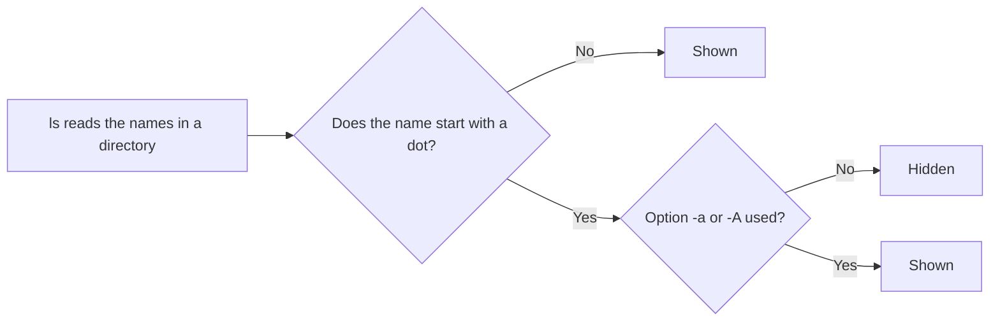

# **Hidden Files and Directories**

## **What Are They?**

In Linux, a file or directory is **hidden** when its name starts with a dot (`.`). Examples: `.bashrc`, `.ssh`, `.git`.

- There is no special setting. The dot in the name is the only thing that makes it hidden.
- Hidden files are skipped by `ls` and by graphical file managers.
- They are not secret or protected. Anyone can see them with the right option.

The purpose is to keep **configuration files** out of sight, so your home directory is not full of clutter. The idea began in early Unix as a shortcut to hide `.` and `..`, and then people used it for configuration files too.



---

## **Show Hidden Files**

| Command | What it shows |
|---|---|
| `ls` | Only normal files |
| `ls -a` | All files, including hidden ones, plus `.` and `..` |
| `ls -A` | All hidden files, but not `.` and `..` |
| `ls -la` | Long format with all files |
| `ls -ld .name` | Details of one hidden file or directory |

`-A` is usually cleaner, because `.` and `..` are not files you work with.

In graphical file managers, press `Ctrl+H` to show or hide hidden files. This works in Nautilus on Ubuntu.

---

## **Create Hidden Files and Directories**

Put a dot at the start of the name.

```bash
touch .notes.txt          # hidden file
mkdir .private            # hidden directory
mv report.txt .report.txt # hide an existing file by renaming it
mv .report.txt report.txt # show it again
```

Only the **name you list** is hidden. Inside a hidden directory, files are normal. You can `cd` into it, and `ls` works as usual:

```bash
cd .private
ls
```

---

## **The Special Entries `.` and `..`**

Every directory contains two entries that `ls -a` shows:

| Entry | Means | Example |
|---|---|---|
| `.` | The current directory | `./script.sh`, `cp file.txt .` |
| `..` | The parent directory | `cd ..`, `ls ..` |

- They are hidden because they start with a dot.
- They exist in **every** directory. A new, empty directory still shows `.` and `..` with `ls -a`.
- The parent of `/` is `/` itself. Running `cd ..` at the top of the tree keeps you there.

---

## **Moving Around with `.` and `..`**

These shortcuts are how you move through the tree. Full path rules (absolute and relative paths) are in Phase 2.

| Command | What it does |
|---|---|
| `pwd` | Prints the directory you are in |
| `cd ..` | Goes up one level, to the parent |
| `cd ../..` | Goes up two levels |
| `cd ../../..` | Goes up three levels |
| `cd .` | Stays in the same directory. Rarely used on its own. |
| `cd` | Goes to your home directory |
| `cd ~` | Goes to your home directory. Same as `cd`. |
| `cd -` | Goes back to the previous directory and prints its name |

Notes:

- `~` is a shortcut for your home directory, for example `/home/akshay`. It works with other commands too, such as `ls ~`.
- `cd -` uses the shell variable `OLDPWD`, which holds the last directory you were in. Use it to jump between two places.
- Write a space after `cd`. `cd..` fails on Linux.

Example session:

```text
akshay@ubuntu:~/Documents/project/temp$ pwd
/home/akshay/Documents/project/temp
akshay@ubuntu:~/Documents/project/temp$ ls -a
.  ..
akshay@ubuntu:~/Documents/project/temp$ cd ../../..
akshay@ubuntu:~$ pwd
/home/akshay
akshay@ubuntu:~$ cd -
/home/akshay/Documents/project/temp
```

---

## **Common Hidden Files and Directories**

Most of these are in your home directory (`~`).

| Name | Purpose | Covered in |
|---|---|---|
| `.bashrc` | Settings for each new interactive bash shell: aliases, prompt | Phase 11 |
| `.profile`, `.bash_profile` | Settings for login shells | Phase 11 |
| `.bash_logout` | Commands run when a login shell exits | Phase 11 |
| `.bash_history` | List of commands you typed | Phase 1 |
| `.ssh/` | SSH keys and settings | Phases 18, 21 |
| `.config/` | Settings of many programs | |
| `.local/` | User-installed data and programs | |
| `.cache/` | Temporary data kept by programs. Safe to delete. | |
| `.vimrc` | Settings for vim | Phase 10 |
| `.gitconfig` | Your Git name, email, and settings | Phase 22 |
| `.git/` | The history of a Git project, inside the project folder | Phase 22 |
| `.gnupg/` | GPG encryption keys | |
| `.docker/` | Docker client settings | Phase 22 |
| `.env` | Settings for a project. Often contains passwords. | |

These are called **dotfiles**. Many people keep them in a Git repository to copy their setup to new machines.

---

## **Hidden Files and Wildcards**

A wildcard such as `*` does **not** match names that start with a dot. This affects many commands.

| Command | Result |
|---|---|
| `ls *` | Skips hidden files |
| `cp -r project/* backup/` | Does not copy hidden files such as `.env` or `.git` |
| `rm *` | Does not delete hidden files |

To include hidden files:

| Goal | Use |
|---|---|
| Copy a directory with everything inside | `cp -r project/. backup/` |
| Match hidden names only, without `.` and `..` | `.[!.]*` |
| Make `*` match hidden files too | `shopt -s dotglob` (undo with `shopt -u dotglob`) |

Preview a wildcard with `echo` before you use it with `rm`:

```bash
echo .[!.]*
```

Be careful with `.*`. On older versions of bash it also matches `.` and `..`. Bash 5.2 and newer skip them. Do not run `rm -r .*`.

---

## **Hidden Files in Linux and Windows**

| | Linux | Windows |
|---|---|---|
| How a file is hidden | The name starts with `.` | A "hidden" attribute is set on the file |
| Change it | Rename the file | Change the file's properties |

On WSL2, files under `/mnt/c` that Windows marks as hidden are not hidden in Linux unless their name starts with a dot.

---

## **Try It**

**1. Create and show hidden files**

```bash
mkdir ~/hidden-lab && cd ~/hidden-lab
touch visible.txt .hidden.txt
mkdir .secret-dir
echo "top secret" > .secret-dir/note.txt
ls
ls -a
ls -A
ls -la
```

Example output:

```text
visible.txt
.  ..  .hidden.txt  .secret-dir  visible.txt
.hidden.txt  .secret-dir  visible.txt
total 12
drwxr-xr-x  3 akshay akshay 4096 ... .
drwxr-x--- 12 akshay akshay 4096 ... ..
-rw-r--r--  1 akshay akshay    0 ... .hidden.txt
drwxr-xr-x  2 akshay akshay 4096 ... .secret-dir
-rw-r--r--  1 akshay akshay    0 ... visible.txt
```

Sizes and numbers will differ on your system.

**2. Read inside a hidden directory**

```bash
cat .secret-dir/note.txt
ls .secret-dir
```

Both work. Only the name `.secret-dir` is hidden.

**3. Hide and show an existing file**

```bash
mv visible.txt .visible.txt
ls
ls -A
mv .visible.txt visible.txt
```

**4. See how wildcards treat hidden files**

```bash
echo *
echo .[!.]*
shopt -s dotglob
echo *
shopt -u dotglob
```

Expected output:

```text
visible.txt
.hidden.txt .secret-dir
.hidden.txt .secret-dir visible.txt
```

**5. The copy trap**

```bash
mkdir proj backup1 backup2
touch proj/a.txt proj/.env
cp -r proj/* backup1/
cp -r proj/. backup2/
ls -A backup1 backup2
```

```text
backup1:
a.txt

backup2:
.env  a.txt
```

The first copy missed `.env`.

**6. An empty directory still has `.` and `..`**

```bash
mkdir empty
ls empty
ls -a empty
```

The first command prints nothing. The second prints:

```text
.  ..
```

**7. Move with `.` and `..`**

```bash
cd ~/hidden-lab
mkdir -p a/b/c
cd a/b/c
pwd
cd ..
pwd
cd ../..
pwd
cd -
cd
pwd
cd /
cd ..
pwd
```

Expected output, with your own home path:

```text
/home/akshay/hidden-lab/a/b/c
/home/akshay/hidden-lab/a/b
/home/akshay/hidden-lab
/home/akshay/hidden-lab/a/b
/home/akshay
/
```

The line from `cd -` is the previous directory. The last `pwd` prints `/`, because the parent of `/` is `/`.

**8. Look at your home directory**

```bash
cd ~
ls -A
head -n 5 ~/.bashrc
ls -ld ~/.ssh
```

`.ssh` exists only if you have used SSH. If not, you get `No such file or directory`.

**9. Clean up**

```bash
cd ~
rm -r ~/hidden-lab
```

---

## **Common Mistakes**

| Mistake | What happens | Fix |
|---|---|---|
| Thinking a hidden file is secure | Anyone can see it with `ls -a` | Use permissions to protect files (Phase 9) |
| Thinking your files vanished because `ls` shows nothing | They are hidden | Run `ls -a` |
| Copying with `cp -r dir/* dest/` | Hidden files are left behind | Use `cp -r dir/. dest/` |
| Running `rm -r .*` | May match `..` on older shells and reach the parent directory | Preview with `echo .[!.]*`. Delete names one by one. |
| Typing `bashrc` instead of `.bashrc` | `No such file or directory` | Include the dot |
| Typing `cd..` without a space | `command not found` | Write `cd ..` |
| Deleting `.git`, `.ssh`, or `.gnupg` | Loses project history or keys | Back them up first. Know what a folder is before you remove it. |
| Editing `.bashrc` with no backup | A mistake can break every new shell | Run `cp ~/.bashrc ~/.bashrc.bak` first |
| Committing `.env` to Git | Passwords become public | Add `.env` to `.gitignore` |
| Looking for hidden files with plain `ls -l` | They are not listed | Use `ls -la` or `ls -lA` |

---

## **Summary**

- A file or directory is hidden when its name starts with a dot. Nothing else changes.
- Show hidden files with `ls -a`, or `ls -A` to skip `.` and `..`.
- Hiding is not security. Use permissions for that.
- `.` is the current directory and `..` is the parent directory. Every directory has both, even an empty one.
- `cd ..` goes up, `cd` or `cd ~` goes home, and `cd -` goes back to the last directory.
- Configuration lives in hidden "dotfiles" in your home directory, such as `.bashrc`, `.ssh/`, and `.config/`.
- Wildcards like `*` skip hidden names. Use `cp -r dir/. dest/`, `.[!.]*`, or `shopt -s dotglob`.
- Preview a wildcard with `echo` before you use it with `rm`.
- Back up a dotfile before you edit it.

---

## **Practice**

1. What makes a file hidden in Linux?
2. What is the difference between `ls -a` and `ls -A`?
3. Create a hidden file `.todo` and a hidden directory `.stuff`. Show them with `ls -A`.
4. Can you `cat` a file inside a hidden directory? Try it.
5. What do `.` and `..` mean? Which command uses each?
6. Create an empty directory and run `ls -a` on it. What do you see?
7. From `~/a/b/c`, how do you reach `~` with one `cd` command using `..`? Which shorter command also works?
8. What does `cd -` do? Which variable does it use?
9. What happens if you run `cd ..` while you are in `/`?
10. Run `ls -A ~`. Name five hidden items in your home directory.
11. What does `.bashrc` do?
12. Why does `cp -r project/* backup/` miss `.env`? Give two ways to include it.
13. What does `echo .[!.]*` show in a folder with hidden files?
14. Why is `rm -r .*` dangerous?
15. Is a hidden file safe from other users? How do you protect a file?
16. How does Windows hide files differently?